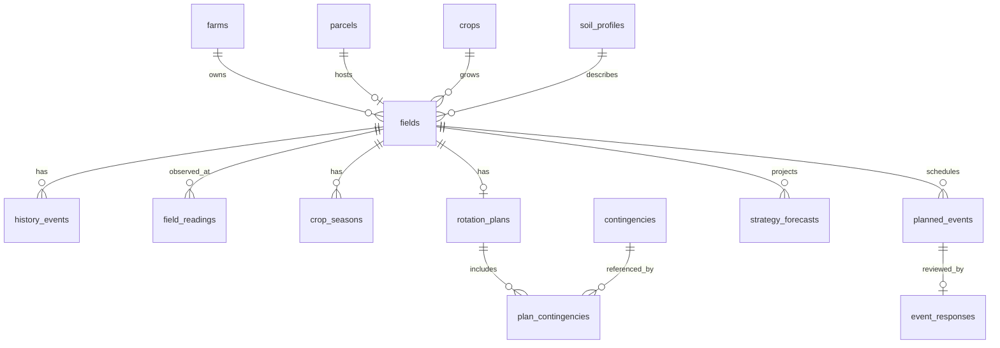

# JSON collection model

Each `.json` file contains an array of records with a unique `id` primary key.
The repository loads a private copy of these collections per application instance,
validates foreign keys, and joins records for API responses. Array positions and
record order have no meaning. Edit these JSON files and restart the backend to
change the seed dataset.

Fields and related entities use UUID strings. Seeded IDs are fixed in these files;
new fields and their related records receive UUID v4 IDs. Parcel numbers are
independent land identifiers, not field IDs. A recreated field receives a new ID.
Reference/template collections may use natural keys, such as a technical parameter
code, team slug, or source key.

| Collection | Ownership / relationships |
| --- | --- |
| `fields` | `farmId → farms`, `parcelId → parcels`, `cropId → crops`; owns boundary geometry, planting information, and `properties` |
| `soil_profiles` | Soil, terrain, and water measurements; referenced by `fields.properties.soilProfileId` and `parcels.soilProfileId` |
| `parcels` | `farmId → farms`, soil survey reference, suggested crop, and surveyed land boundary |
| `crops` | Crop catalog, default crop properties, planting/harvest windows, `nextCropId → crops` |
| `field_readings` | `fieldId → fields`; dated health, moisture, and nitrogen observations; current field values come from the latest row |
| `history_events` | Historical observations and work records, `fieldId → fields` |
| `crop_seasons` | `fieldId → fields`, `cropId → crops`; one historical/current season per field/year |
| `rotation_plans` | `fieldId → fields`, `nextCropId/followingCropId → crops`; stored outlook and assumptions |
| `planned_events` | `fieldId → fields`, `checkpointId → checkpoints`; scheduled work, with no copied field name |
| `strategy_forecasts` | `fieldId → fields`; dated forecast snapshots |
| `strategy_technicals` | `fieldId → fields`; recorded technical inputs and explanations |
| `strategy_comparisons` | `fieldId → fields`; current/projected metric snapshots |
| `recommendations` | `fieldId → fields`; recorded recommendation text |
| `checkpoints` | Reusable operation review instructions |
| `contingencies` | Reusable conditional guidance |
| `plan_contingencies` | Join collection: `planId → rotation_plans`, `contingencyId → contingencies` |
| `event_responses` | `eventId → planned_events`; status and reviewed-content fingerprint; initially empty |
| `notifications` | `farmId → farms`, optional `fieldId → fields`; field names are joined |
| `farms` | `ownerId → users`, `weatherStationId → weather_stations`; location and season information |
| `users` | Demo owner identity and preferences |
| `planning_contexts` | `farmId → farms`; demo season clock |
| `weather_stations` | Weather locations |
| `current_weather` | `stationId → weather_stations`; current observation |
| `weather_forecasts` | `weatherId → current_weather`; forecast days |
| `weather_history` | `stationId → weather_stations`; historical observations |
| `team_members`, `demo_sources` | Independent help content |
| `event_templates`, `technical_templates` | Reference defaults used only to provision a new field's related records |

A field's `properties` contains a soil-profile foreign key, field-specific crop
attributes, growth stage, sampling metadata, cultivation practice, and tenure.
`GET /fields/{guid}` expands that into full `properties.soil` and `properties.crop`
objects alongside `geometry`. `/properties` returns the same property projection.
Geometry uses GeoJSON `[longitude, latitude]` coordinates.

Overview charts select stored observations; a new field has no invented historical observations.
Current health, moisture, and nitrogen are joined from the latest `field_readings` record.

History and planning reads select records by foreign key, join crop labels and
current field names, and sort by date. They do not regenerate historical data.
New-field provisioning builds a fresh demo schedule and related records once,
before insertion. A new field starts with its current planting/registration record;
it does not inherit the removed field's history, forecasts, or decisions.

Deleting a field cascades through field-owned records, plans, plan-contingency
links, events, and event responses. It preserves the parcel, soil survey, crop
catalog, and shared guidance. All creation/deletion/decision mutations happen in
memory under a lock and reset on backend restart; JSON seed files are not rewritten.
This is a database-shaped fixture store, with no database or persistent write layer.
