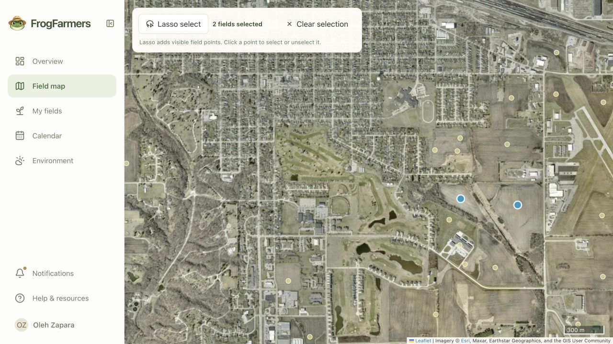

# Local field selection

The field map builds a temporary selection using catalog UUIDs. It does not add,
remove, save, or process fields through the API. Existing saved farm membership
remains separate from the draft selection. Selected points are blue; clearing the
draft restores each point's normal styling.

- Click a field point to toggle it, including while the lasso is active.
- Enable **Lasso select**, then drag a loop around visible points. Release to add
  enclosed points. Additional lassos add to the selection without duplicates.
- Click a selected point to remove it from the draft.
- **Escape** exits the lasso and cancels an unfinished stroke. Map dragging and
  zoom controls return to their previous enabled state.
- **Clear selection** clears the entire draft, including offscreen selections.
- Panning retains selections. Leaving or refreshing the map clears them.

Lasso selection works only on loaded individual points. At broad or dense zooms,
cluster markers remain zoom targets; the tool asks the user to zoom in. It never
expands clusters or fetches the full catalog. A lasso uses the points visible when
the stroke begins, includes boundary points, supports concave and self-crossing
loops, and ignores click-sized or line-only strokes. Pointer cancellation, window
blur and resizing discard unfinished strokes. Mouse, pen and touch pointers use
the same gesture path.

The outline updates at most once per animation frame, with at most 512 sampled
vertices. Geometry checks are bounded by the existing 600-feature viewport limit.
Selection highlighting updates existing canvas markers in place and does not
refetch map data or rebuild layers on each selection change.

`tests/lassoSelection.test.mjs` checks containment, projection, cluster exclusion,
degenerate strokes, additive selection, toggles, immutability and marker styling.
Browser checks covered point toggles in both modes, drag capture without panning,
Escape, selection retention while panning, and clearing. Full freehand-loop
containment is covered by geometry tests; the browser input tool only supports
straight drag paths.

